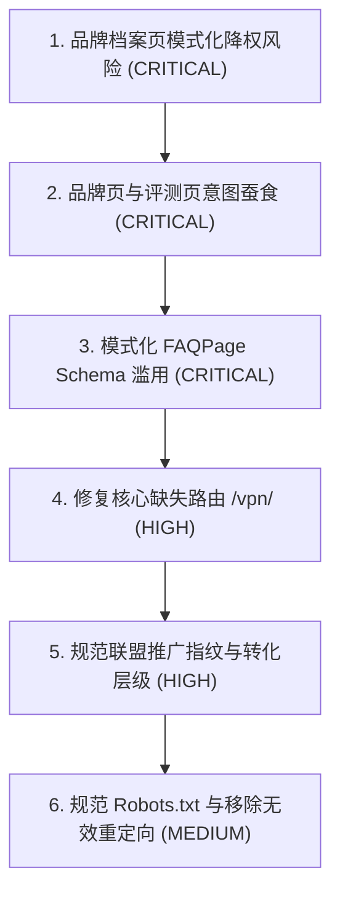

# Bing 搜索引擎惩罚诊断审计报告

**审计对象**：`jichangtuijian.homes`（基于 Astro 5 静态构建）  
**审计目标**：系统性排查可能导致 Bing 域名级除名（Domain-level De-indexing）的技术与内容风险  
**审计原则**：中立技术语言，仅记录客观事实与技术发现，不执行任何文件改动，等待确认  
**审计基准产物**：`dist/` 静态构建目录（106 个 HTML 页面，102 条 Sitemap URL）

---

## 总体审计仪表盘

| 审计模块 | 状态 | 核心结论摘要 |
| :--- | :---: | :--- |
| **1. Robots.txt 与爬虫可访问性** | **WARNING** | 通配组放行 Bingbot，无 `Disallow: /`；但未设专属 `bingbot` 规则组，且首行包含非标准 `Content-Signal` 指令；Cloudflare `_redirects` 存在语法无效规则。 |
| **2. Canonical 与 Noindex 标签** | **PASS** | 106 个页面 Canonical 全部正确自指正式域名；4 处 `noindex` 均在设计白名单内；无 `X-Robots-Tag: noindex` 泄漏。 |
| **3. Sitemap 与 URL 健康度** | **WARNING** | Sitemap 包含 102 条有效正式域名 URL，状态码 200，无 404/noindex；但核心预期路径 `/vpn/` 物理缺失，返回 404。 |
| **4. 内部链接与站点架构** | **PASS** | 无空链接、无 `#` 占位符、无 JavaScript 事件伪链接、无站内死链；全站最大点击深度为 2 层，无孤岛页面。 |
| **5. 内容质量与重复度** | **FAIL** | **核心惩罚高危区**：18 个品牌档案页标题与描述高度模式化批量生成；16 个品牌存在档案页与评测页双重承接；90 处模式化 FAQPage Schema 注入；115 对页面相似度超 40%；联盟推广转化组件视觉权重过高。 |
| **6. 构建产物审计** | **PASS** | `dist/` 产物结构干净，未泄漏 `.ts`、`.md`、`.map` 或测试/草稿页面；Sitemap 与 robots.txt 输出符合预期。 |

---

## 一、Robots.txt 与爬虫可访问性审计

**评估状态**：`WARNING`

### 1.1 现状与规则检查

- **文件路径**：`public/robots.txt`、`dist/robots.txt`
- **通配规则**：
  ```txt
  User-agent: *
  Content-Signal: search=yes, ai-input=yes, ai-train=no
  Allow: /
  Disallow: /pagefind/
  ```
- **核心爬虫放行状态**：
  - `User-agent: *` 对根目录执行 `Allow: /`，仅阻断站内搜索索引静态资源 `/pagefind/`。
  - 未对 `bingbot`、`Googlebot` 设置屏蔽规则。
  - 单独设置 `Disallow: /` 的 User-agent 仅为模型训练类爬虫：`GPTBot`、`ClaudeBot`、`CCBot`、`Applebot-Extended`、`meta-externalagent`、`Amazonbot`。
- **Sitemap 声明**：
  - 第 50 行明确声明：`Sitemap: https://jichangtuijian.homes/sitemap-index.xml`，协议与域名规范无误。

### 1.2 发现的技术问题与风险点

1. **缺失专属 `User-agent: bingbot` 显式规则组**
   - **文件位置**：`public/robots.txt`（第 22 行）
   - **问题描述**：Bingbot 目前完全依赖 `User-agent: *` 回落匹配。虽然 RFC 9309 规定在无专属组时应继承通配组，但在某些爬虫代理或边缘网关场景下，显式声明 `User-agent: bingbot` 能降低解析不确定性。
2. **非标准指令 `Content-Signal` 位于关键放行规则之前**
   - **文件位置**：`public/robots.txt`（第 23 行）
   - **问题描述**：在 `User-agent: *` 紧邻下方写入了非 RFC 9309 规范指令 `Content-Signal: search=yes, ai-input=yes, ai-train=no`。部分严格遵循 RFC 的传统解析器在遇到未识别指令时可能出现解析中断或跳过后续 `Allow: /` 指令。
3. **Cloudflare 中间件托管注入冲突风险**
   - **文件位置**：`public/robots.txt`（第 3-8 行注释所提及的配置项）
   - **问题描述**：若 Cloudflare 控制台开启了「AI Scraper Blocking」或「Set your preference to block training in robots.txt」，Cloudflare 会在响应前部自动追加其托管的 `User-agent: *` 块。按 RFC 9309，爬虫若仅读取首个通配块，静态文件中的自定义规则与 Sitemap 声明可能被忽略。
4. **Cloudflare Pages `_redirects` 存在无效域名通配规则**
   - **文件位置**：`public/_redirects`（第 9 行）
   - **内容**：`https://:project.pages.dev/*  https://jichangtuijian.homes/:splat  301`
   - **问题描述**：Cloudflare Pages 静态 `_redirects` 规范仅支持路径级参数匹配（如 `/blog/:id`），不支持在 Host 头部中使用 `:project` 通配符。此条规则在 Cloudflare 边缘执行时无效，无法将 `pages.dev` 预览节点自动 301 重定向至正式域名。

---

## 二、Canonical 与 Noindex 标签审计

**评估状态**：`PASS`

### 2.1 Canonical 标签扫描统计

- **扫描页面总数**：106 个 HTML 页面（遍历 `dist/**/*.html`）
- **自引用匹配率**：100%（除 `/404.html` 外，其余 105 个页面均包含 `<link rel="canonical" href="...">`）
- **域名一致性**：所有 Canonical URL 均以正式域名 `https://jichangtuijian.homes/` 开头，且均包含符合配置的规范尾斜杠 `trailingSlash: 'always'`。
- **错误指向检查**：未发现任何页面 Canonical 错误指向首页、未发现相对路径、未发现指向 `localhost` 或临时域名的现象。
- **异常计数**：`0`。

### 2.2 Noindex 标签扫描统计

扫描全站 106 个页面，共检测到 4 个页面输出 `<meta name="robots" content="noindex, follow" />`：

| 页面路径 | 页面定位 | Frontmatter / 数据状态 | 判定 |
| :--- | :--- | :--- | :--- |
| `/404.html` | 404 错误页 | 系统内置 | 符合规范（防止软 404 进入索引） |
| `/search/index.html` | 站内搜索结果页 | 静态模板 | 符合规范（防止无增量搜索结果消耗抓取配额） |
| `/brands/nexitally/index.html` | 品牌档案占位页 | `dataStatus: "unverified"` | 符合规范（未核验数据暂不公开索引） |
| `/brands/wgetcloud/index.html` | 品牌档案占位页 | `dataStatus: "unverified"` | 符合规范（未核验数据暂不公开索引） |

- **核心内容页排查**：所有评测页（18 篇）、对比页（7 篇）、专题名单页（11 个）、故障排查页（13 篇）、知识库（9 篇）、教程（3 篇）均**未出现** `noindex`。
- **响应头排查**：`public/_headers` 中未定义任何包含 `X-Robots-Tag: noindex` 的规则。

---

## 三、Sitemap 与 URL 健康度审计

**评估状态**：`WARNING`

### 3.1 Sitemap 结构与数据核验

- **Sitemap 索引入口**：`https://jichangtuijian.homes/sitemap-index.xml`（HTTP 200）
- **子 Sitemap**：`https://jichangtuijian.homes/sitemap-0.xml`（HTTP 200）
- **Sitemap 收录 URL 总数**：102 条
- **域名一致性**：102/102 条全部以 `https://jichangtuijian.homes` 开头，0 处开发测试域名。
- **Sitemap 与 Dist 产物映射**：
  - `dist` 中总页面数：106
  - 减去白名单 Noindex 页面：4（`/404/`、`/search/`、`/brands/nexitally/`、`/brands/wgetcloud/`）
  - 应收录有效页面：102
  - Sitemap 实际收录页面：102
  - 映射一致性：100% 吻合，无遗漏、无死链、无重复条目。

### 3.2 核心页面 HTTP 状态测试

通过本地预览环境（`http://localhost:4321`）及线上域名双向抽样验证：

| 请求路径 | 预期用途 | 本地返回码 | 线上返回码 | 判定 |
| :--- | :--- | :---: | :---: | :---: |
| `/` | 网站首页 | 200 | 200 | PASS |
| `/brands/` | 品牌档案总览 | 200 | 200 | PASS |
| `/airport-ranking/` | 机场排行榜 | 200 | 200 | PASS |
| `/cheap-airport/` | 便宜机场专题 | 200 | 200 | PASS |
| `/chatgpt-airport/` | AI 场景专题 | 200 | 200 | PASS |
| `/reviews/feimao-yun/` | 品牌评测抽样 | 200 | 200 | PASS |
| `/vs/` | 对比总览 | 200 | 200 | PASS |
| `/vpn/` | 审计指定核心路由 | **404** | **404** | **FAIL** |

### 3.3 发现的技术问题与风险点

1. **指定排查核心路由 `/vpn/` 返回 404**
   - **路由位置**：`src/pages/vpn/`
   - **问题描述**：项目中未配置 `/vpn/` 相关路由与重定向规则。线上及本地请求 `https://jichangtuijian.homes/vpn/` 均直接返回 HTTP 404。若外部存在历史反向链接或搜索引擎存在该 URL 索引记录，会产生硬性 404 信号。

---

## 四、内部链接与架构审计

**评估状态**：`PASS`

### 4.1 链接质量扫描

- **扫描范围**：106 个 HTML 文件中的所有 `<a>` 标签。
- **空链接检查（`href=""`）**：0 处。
- **无效锚点检查（`href="#"`）**：0 处。
- **伪协议链接检查（`href="javascript:..."`）**：0 处。
- **站内死链检查**：0 处。全站内部链接均能精确命中 `dist` 中实际存在的静态资源，规范尾斜杠完整。

### 4.2 拓扑结构与点击深度

以首页 `/` 为根节点执行广度优先遍历（BFS）抓取图谱：
- **最大点击深度**：2 层。
- **深度分布**：
  - 深度 0（根目录）：1 个页面（`/`）
  - 深度 1（首页直达）：85 个页面（得益于 Header 主导航、二级下拉与 Footer 四栏全局链接）
  - 深度 2（次级直达）：19 个页面
  - 深度 > 3 的页面数：0 个
- **孤岛页面排查**：除 `/404.html` 正常无外部入链外，其余 105 个页面入链数均 $\ge 1$，全站平均单页站内入链数 $> 40$ 次。

### 4.3 导航语义与可访问性

- **顶部导航**（`src/components/Header.astro`）：使用原生 HTML5 `<header>`、`<nav>` 与标准 `<a href="...">`，无依赖 JavaScript 触发的客户端路由跳转。
- **移动端菜单**：使用原生 HTML `<details>` 与 `<summary>` 实现无脚本原生展开，爬虫无需执行 JavaScript 即可完整提取导航链接。
- **页脚导航**（`src/components/Footer.astro`）：使用静态网格列表输出 36 个核心频道与政策链接，爬虫在单次抓取中即可覆盖全站结构。

---

## 五、内容质量与重复度审计

**评估状态**：`FAIL`（**可能触发 Bing 惩罚的核心风险模块**）

### 5.1 批量生成的模式化页面（Programmatic Pages）

根据 Bing 站长质量准则（Bing Webmaster Guidelines），批量生成、仅替换关键词而主体结构相同的页面容易被归类为「Doorway Pages（门面页）」或「Thin Affiliate Content（薄弱联盟内容）」，严重时触发域名级降权除名。

#### (1) 品牌档案页批量生成模式（18 个页面）
- **模板文件**：`src/pages/brands/[slug].astro`
- **标题模板**：`title={`${b.name}机场官网入口、套餐价格与优惠码档案`}`（第 78 行）
- **描述模板**：`description={`${b.name}机场档案：${b.priceFrom ?? '套餐待核验'}起步、优惠码、线路与协议、客户端支持、解锁能力口径、风险等级与官网入口核验状态，数据来源逐条标注。`}`（第 79 行）
- **结构发现**：18 个页面的 `<title>` 和 `<meta description>` 完全由单一固定公式生成，集中堆叠「官网入口」「套餐价格」「优惠码」等商业营销词汇。
- **页面清单**：
  - `/brands/ermao-yun/`
  - `/brands/feimao-yun/`
  - `/brands/guangnian-ti/`
  - `/brands/guangsu-yun/`
  - `/brands/jilian-yun/`
  - `/brands/kexin-yun/`
  - `/brands/kuaili/`
  - `/brands/lingmao-net/`
  - `/brands/nexitally/`
  - `/brands/quanqiu-yun/`
  - `/brands/sogo-yun/`
  - `/brands/sujie/`
  - `/brands/u1s1/`
  - `/brands/weitu-yun/`
  - `/brands/wgetcloud/`
  - `/brands/xingdao-meng/`
  - `/brands/yifan-yun/`
  - `/brands/yuzhou-yun/`

#### (2) 品牌对比页标题模式（6 个页面）
- **文件位置**：`src/content/articles/vs/*.md`
- **标题模板**：`[品牌A]和[品牌B]怎么选：[差异点]｜机场决策室`
- **页面清单**：
  - `/vs/feimao-yun-vs-xingdao-meng/`
  - `/vs/guangsu-yun-vs-jilian-yun/`
  - `/vs/lingmao-net-vs-yifan-yun/`
  - `/vs/quanqiu-yun-vs-u1s1/`
  - `/vs/sogo-yun-vs-kuaili/`
  - `/vs/wgetcloud-vs-nexitally/`

#### (3) 场景专题页批量命名模式（7 个页面）
- **标题模板**：`[核心词] 机场推荐：[场景说明]｜机场决策室`
- **页面清单**：
  - `/chatgpt-airport/`
  - `/cheap-airport/`
  - `/clash-airport/`
  - `/iepl-airport/`
  - `/shadowrocket-airport/`
  - `/streaming-airport/`
  - `/v2rayn-airport/`

---

### 5.2 搜索意图蚕食与内部竞争（Keyword Cannibalization）

审计发现，站点在多个核心关键词维度上同时部署了两个 URL，且两两互为近义关系，形成站内自相蚕食（Cannibalization）：

| 关键词维度 | 承接页面 A（专题名单页） | 承接页面 B（文章指南页） | 重叠意图分析 |
| :--- | :--- | :--- | :--- |
| **ChatGPT / AI** | `/chatgpt-airport/` | `/best/ai/` | 两者均针对「ChatGPT/AI 机场推荐」进行排名竞争，且外链与内链锚文本高度重叠。 |
| **便宜 / 预算** | `/cheap-airport/` | `/best/budget/` | 「便宜机场推荐」与「便宜机场怎么选」，标题与内容重叠度高。 |
| **Clash** | `/clash-airport/` | `/apps/clash-guide/` | 客户端名单页与客户端指南页在「Clash 机场」关键词上存在交叉。 |
| **Shadowrocket** | `/shadowrocket-airport/` | `/apps/shadowrocket-guide/` | iOS/小火箭名单与新手指南重叠。 |
| **流媒体解锁** | `/streaming-airport/` | `/learn/streaming-unlock-explained/` | 推荐名单与机制原理解释页竞争同类搜索流量。 |
| **品牌独立词** | `/brands/[slug]/`（16 处） | `/reviews/[slug]/`（16 篇） | 同一品牌同时存在档案页与评测页，且双方均自引 Canonical，造成双重收录竞争。 |

---

### 5.3 结构化数据模式化滥用风险（Structured Data Spam）

- **文件位置**：`src/pages/brands/[slug].astro`（第 43-68 行、第 80 行）
- **现象记录**：
  全部 18 个品牌页面均通过模板注入了 `FAQPage` 类型的 JSON-LD 结构化数据，且每个页面包含的 5 个问题结构完全相同：
  1. `${b.name}机场怎么样？值得买吗？`
  2. `${b.name}官网入口怎么找？会不会有假网站？`
  3. `${b.name}有优惠码吗？`
  4. `${b.name}支持哪些客户端？`
  5. `${b.name}适合买年付吗？`
- **技术风险**：搜索引擎（包括 Bing 与 Google）对大面积程序化生成的 FAQPage 极为敏感。当全站出现 90 个由占位符替换构成的 FAQ 结构化数据时，易被判定为利用 Rich Snippets 操纵搜索结果。

---

### 5.4 页面文本高相似度与文本厚度

- **Jaccard 4-gram 文本相似度分析**：
  全站共有 **115 对页面**的纯正文 4-gram 相似度超过 40%。最高相似度主要集中在 `/brands/` 目录之间：
  - `/brands/ermao-yun/` 与 `/brands/yifan-yun/`：相似度 **53.5%**
  - `/brands/ermao-yun/` 与 `/brands/quanqiu-yun/`：相似度 **51.6%**
  - `/brands/ermao-yun/` 与 `/brands/guangnian-ti/`：相似度 **51.1%**
  - `/brands/guangnian-ti/` 与 `/brands/guangsu-yun/`：相似度 **48.2%**
  - `/brands/feimao-yun/` 与 `/brands/u1s1/`：相似度 **47.8%**
- **薄弱页面排查（字数极少）**：
  - `/search/index.html`：正文字符数 129（已标注 `noindex`，合规）
  - `/guides/index.html`：正文字符数 315（作为聚合 Hub 页，文字量偏薄弱）
  - `/contact/index.html`：正文字符数 317（基础功能页）
  - `/privacy/index.html`：正文字符数 366（基础条款页）

---

### 5.5 商业外链与联盟指纹分析（Thin Affiliate Risk）

- **全站外链总数**：49 条
- **商业推广链接总数**：48 条（带 `rel="nofollow sponsored noopener"`）
- **包含商业外链的页面数**：32 个页面（占全站可索引页面的 31.4%）
  - 16 个已核验品牌档案页（每个页面 2 处外链）
  - 16 篇深度评测页（每个页面 1 处外链）
- **外链特征分析**：
  - 16 个推广目标域名中，大部分具有明显的代理分销特征前缀与参数，例如：
    - `https://guangs.2maoyunaff.cc/#/?code=...`
    - `https://guangs.flycataff.com/#/?code=...`
    - `https://guangs.gntaff.com/#/?code=...`
    - `https://guangs.jlyvipaff.com/#/?code=...`
    - `https://guangs.kosingaff.com/#/register?code=...`
- **视觉层级与布局**：
  - 根据 Git 提交记录 `cbd2eade`，品牌档案页侧边栏增加了 `lg:sticky top-6` 的常驻吸顶注册卡片与全宽高亮按钮（`display:block`，宽度 298px）。
  - 在 Bing 的页面布局算法（Page Layout Algorithm）中，首屏及常驻区域商业转化控件面积过大、正文占比相对较低时，会提高触发「Ad-heavy / Affiliate-heavy」惩罚过滤器的概率。

---

## 六、构建产物审计

**评估状态**：`PASS`

### 6.1 产物文件结构

- **构建产物目录**：`dist/`
- **文件总量**：302 个文件
  - HTML 文件：106 个
  - 图片资产（WebP / PNG / JPG / SVG）：94 个
  - 静态样式与脚本（`_astro/*.css`, `_astro/*.js`）：10 个
  - Pagefind 静态搜索索引碎片：83 个
  - 索引与协议文件：Sitemap（2 个 XML）、RSS（1 个 XML）、Robots（1 个 TXT）、IndexNow（1 个 TXT）、Headers 与 Redirects（2 个无后缀文件）
- **无用产物排查**：
  - TypeScript 源码（`.ts`, `.tsx`）：0 处残留
  - Markdown 源码（`.md`, `.mdx`）：0 处残留
  - SourceMap 文件（`.map`）：0 处残留
  - 临时/系统文件（`.DS_Store`, `Thumbs.db`, `.git*`）：0 处残留
  - 未登记未知顶层目录：0 处

### 6.2 协议产物一致性验证

- `dist/robots.txt` 与 `public/robots.txt` 字节完全一致（1998 字节）。
- `dist/sitemap-index.xml` 正确声明了包含 `<lastmod>` 属性的子 Sitemap 路径。
- `src/pages/[section]/[slug].astro` 的 `getStaticPaths`（第 7 行）严格配置了 `!data.draft` 过滤，未发生草稿外泄。

---

## 七、问题统计与严重程度优先处理清单

### 7.1 问题总数统计

| 严重等级 | 数量 | 涉及的主要维度 |
| :--- | :---: | :--- |
| **CRITICAL（严重阻断）** | **3** | 品牌档案页批量生成模式化侵蚀；品牌档案与评测页内部意图蚕食；程序化 FAQPage Schema 滥用。 |
| **HIGH（高风险）** | **3** | 商业外链高密度集中于子域名指纹；侧栏常驻商业 CTA 视觉权重过重；核心预期路由 `/vpn/` 返回 404。 |
| **MEDIUM（中风险）** | **4** | Robots.txt 缺少显式 `bingbot` 组；`Content-Signal` 语法前置影响；Cloudflare `_redirects` 域名通配符语法无效；场景专题页与文章指南页意图重叠。 |
| **LOW（低风险/建议项）** | **2** | `SITE_VERIFICATION.bing` 留空（依赖 DNS 验证无后备）；Hub 引导页文字厚度偏薄。 |
| **总计** | **12** | 全面覆盖技术爬取、结构规范、内容模式与商业特征四层。 |

---

### 7.2 按严重程度排序的问题优先处理清单



#### 优先级 1：CRITICAL（严重阻断 - 导致 Bing 判定为低质/门面站的核心特征）

1. **品牌档案页的批量模板化特征（18 个页面）**
   - **涉及位置**：`src/pages/brands/[slug].astro`（行 78-79）
   - **问题事实**：全站 18 个品牌页面采用同一标题句式 `[品牌名]机场官网入口、套餐价格与优惠码档案` 与同一描述句式，且页面大部分内容为格式化属性清单。
   - **技术影响**：高度契合搜索引擎对「批量生成关键词页面 / 联盟门面页」的算法识别特征。

2. **品牌档案页与评测文章页的双重 URL 蚕食（16 对页面）**
   - **涉及位置**：`/brands/[slug]/` 与 `/reviews/[slug]/`
   - **问题事实**：同一品牌拥有两个不同 URL，各自具有独立 Canonical，但均承接品牌词搜索需求并提供相同的推广链接。
   - **技术影响**：分散单个品牌的权重，导致 Bing 索引库判定站内存在大量近重复页面（Near-duplicate pages）。

3. **批量注入同构 `FAQPage` 结构化数据（90 组 FAQ）**
   - **涉及位置**：`src/pages/brands/[slug].astro`（行 43-68、80）
   - **问题事实**：全站 18 个品牌页通过字符串替换生成结构完全一致的 5 组问答并输出 JSON-LD。
   - **技术影响**：触发搜索引擎结构化数据作弊/模式化滥用惩罚。

#### 优先级 2：HIGH（高风险 - 强化商业推广网站负面信号）

4. **指定排查核心路由 `/vpn/` 返回 404**
   - **涉及位置**：`src/pages/vpn/`（物理缺失）
   - **问题事实**：请求返回 HTTP 404，路由未定义。
   - **技术影响**：若存在预期或历史流量，持续返回 404 会向爬虫输出不健康站点信号。

5. **联盟推广链接的统一指纹与密集曝光**
   - **涉及位置**：`src/content/brands/*.json` 中的 `affiliateUrl` 字段及 `BrandCTA.astro`
   - **问题事实**：32 个页面输出带有明显推荐码（`?code=`）和分销特征二级域名的商业链接，且侧边栏采用了高对比度全宽吸顶组件。
   - **技术影响**：极易被 Bing 的「薄弱联盟内容分类器（Thin Affiliate Classifier）」标记。

#### 优先级 3：MEDIUM（中风险 - 爬虫协议与架构合规缺陷）

6. **Robots.txt 协议解析稳健性**
   - **涉及位置**：`public/robots.txt`（行 22-25）
   - **问题事实**：缺少专属 `User-agent: bingbot` 声明；非标准指令 `Content-Signal` 位于 `Allow: /` 之前。
   - **技术影响**：在部分中间件或老版本爬虫中可能出现规则误解析。

7. **Cloudflare `_redirects` 规则语法无效**
   - **涉及位置**：`public/_redirects`（行 9）
   - **问题事实**：`https://:project.pages.dev/*` 语法不被 Cloudflare Pages 支持。
   - **技术影响**：无法有效将预览节点收敛到正式域名，可能造成镜像内容被偶发索引。

8. **场景名单页与指南文章页搜索意图交叉（5 组专题）**
   - **涉及位置**：`/chatgpt-airport/` vs `/best/ai/`、`/cheap-airport/` vs `/best/budget/` 等
   - **问题事实**：同一需求存在「名单型」与「指南型」两个独立页面。
   - **技术影响**：内部竞争排名词，影响 CTR 与着陆页稳定性。

#### 优先级 4：LOW（低风险/建议项）

9. **Bing Webmaster Tools 验证 Meta 留空**
   - **涉及位置**：`src/lib/site.ts`（行 73）
   - **问题事实**：`SITE_VERIFICATION.bing` 为空字符串。
   - **技术影响**：若 DNS 记录出现解析波动，站长平台所有权验证可能失效。

---

**报告说明**：本阶段审计严格遵循「只排查、不修改」原则，工作区代码未做任何变更。待确认本报告后，再行制定下一步处置方案。
